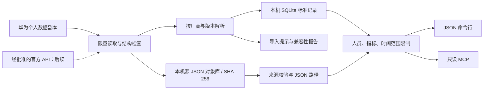

# VitalDock 产品与技术设计

## 项目价值

个人 agent 已能管理文件、日程和知识，但穿戴设备的数据仍分散在厂商应用中。VitalDock 负责“获得数据 → 保存来源 → 统一含义 → 提供可控查询”，让健康数据成为个人 agent 可用的长期资料。

首个用户场景：中国大陆华为账号，其他品牌安卓手机，华为穿戴设备。项目先完成数据获取和可验证的查询，不将医学诊断纳入产品职责。

## 数据流

## 已实现的结构

| 模块 | 责任 |
|---|---|
| `archive.py` | JSON / 文件夹 / ZIP 读取，大小与成员数限制，拒绝不安全成员 |
| `huawei.py` | 导出格式识别、单位检查、已支持数据归一化、明确记录未知格式 |
| `model.py` | 稳定标识、毫秒时间戳、UTC、单位、来源版本 |
| `store.py` | 一次导入一个事务、源文件摘要、重复导入处理、分页查询 |
| `cli.py` | JSON 输入输出边界、检查／导入／覆盖／查询命令 |
| `mcp_server.py` | 固定人员和指标范围的只读本地 agent 接口 |

SQLite 中有 `records`、`objects`、`provenance`、`imports` 和版本信息。原始 JSON 字节存入 `objects/<sha256>`；记录通过 JSON Pointer 指向来源条目。内容相同但文件空白不同的导出会各保留来源对象；数值相同且语义字段相同的记录共用稳定 ID，来源关联可增加。

记录 ID 包含厂商、人员、设备、指标、起止时间、数值、单位、来源类型及限定信息。同一时间不同数值分别保留，不把冲突悄悄覆盖。来自不同设备或不同来源类型的记录分别保留，交给之后明确的数据合并规则处理。

`--profile` 区分账号。导出中的 `subUser` 或体脂成员标识会生成稳定的人员摘要；没有成员标识时归入 profile。摘要只是减少直接标识暴露，不构成匿名化。首版不替用户判断无法识别的成员归属。

## 导入完整性与质量

- `complete`：所选 JSON 未产生兼容性提示，不代表已取回账号的全部历史数据。
- `needs_review`：已保存支持的记录，报告列出未知字段、待核实单位或坏记录。
- `no_supported_records`：源文件已保存，没有可归一化记录。
- 输入或存储异常：整次标准记录事务回滚。`--strict` 在任何兼容性提示出现时也回滚。

源对象在事务内写入文件系统，SQLite 失败后可能留下未引用对象；这些对象仍是本次显式选择的本地源数据，不会被 agent 返回。首版保留这些对象以便审计，后续增加显式检查和清理工具。单个 JSON 最大 64 MiB，一次总读取最大 1 GiB，成员数最多 10,000；更大的文件需要后续流式解析支持。

不会自动删除未知字段、修补损坏 JSON、推断热量缩放倍数或把缺失补为零。所有原始 JSON 均保留。输入结构与 REST 响应结构不同：当前解析器只接受数据副本，不把 REST 的纳秒时间戳当作导出毫秒。

## 官方持续同步的接入设计

实现顺序是先验证资格，再验证协议，最后实现同步：

1. 根据中国大陆、Android 和个人开发者的实际条件，在华为控制台核实产品类型、可申请的数据范围及测试资格。HarmonyOS 元服务文档不能直接当作 Android REST 的审批承诺。
2. 创建应用、配置包名／签名或 Web 回调，申请最小的只读数据范围，保留申请结果。
3. 用户在华为官方授权页面登录；令牌保存在操作系统凭据库。核心存储不持有账号密码，MCP 不暴露凭据。
4. 以授权的人员／指标分组读取。逐页保存原始响应，统一时间单位，核对分页和时间边界。
5. 检查点只在整页原始响应及归一化数据成功提交后推进；使用小范围重叠回查应对延迟记录，并通过稳定 ID 处理重复。
6. 对限流和临时故障退避；对授权撤销停止同步并提示本人重新授权。每个同步任务保存最后成功时间和状态。
7. 个人账号以获批后的轮询为候选。官方订阅通知目前要求企业开发者资格，不能作为本项目个人使用的默认前提。

这些是后续实现的设计要求，0.1.0 没有联网同步器、令牌管理器或伪造的 OAuth 流程。接口的真实接入需要项目所有者在官方控制台完成应用申请和用户授权。

## 逐步扩展

新增厂商沿用 `provider → source object → normalized observation → read interface`。苹果优先评估 Health 导出和经用户授权的手机端桥接，小米先核实其当前可用的个人副本与官方开发者能力，安卓 Health Connect 作为另一种来源评估。它们都属于路线图，未在华为阶段承诺可获取的具体数据范围。

个人诊断、公开托管健康数据库、未经授权的后台账号抓取、任意 SQL 工具、root 读取和验证码绕过不属于首版实现。
